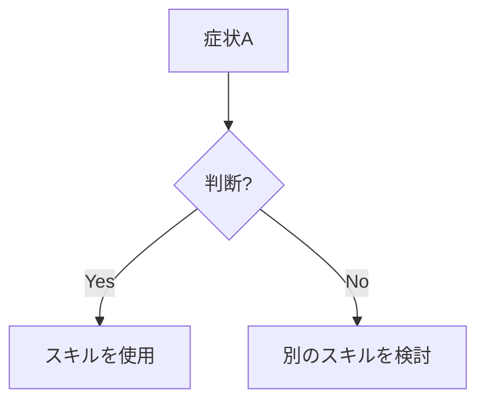

# 発見のための SKILL.md 執筆

superpowers:writing-skills の一部: SKILL.md テンプレートと、エージェントがスキルを見つけ、読むようにするための命名・description・サイズの決め方。

## SKILL.mdの構造

**Frontmatter (YAML):**
- 必須フィールドは`name`と`description`です。その他のフィールドは [Agentskills の仕様](https://agentskills.io/specification) でサポートされているものだけを使います。
- 合計で最大1024文字。
- `name`: 文字、数字、ハイフンのみを使用（括弧、特殊文字は不可）。
- `description`: 三人称で、いつ使用するかのみを記述します（何をするかは記述しない）。
  - 「Use when...」またはトリガー条件に焦点を当てた説明的なフレーズで始めます。
  - 特定の症状、状況、文脈を含めます。
  - **スキルのプロセスやワークフローを絶対に要約しない**（理由はSDOのセクションを参照）。
  - 可能であれば500文字未満に保ちます。

````markdown
---
name: skill-name-with-hyphens
description: Use when [特定のトリガー条件と症状]
---

# スキル名

## 概要
これは何か？中心的な原則を1〜2文で。

## いつ使用するか
[決定が自明でない場合は、小さなインラインのフローチャート]



症状とユースケースの箇条書き
いつ使用しないか

## コアパターン（技術/パターンの場合）
Before/afterのコード比較

## クイックリファレンス
一般的な操作をざっと見るための表または箇条書き

## 実装
単純なパターンのためのインラインコード
重いリファレンスや再利用可能なツールのためのファイルへのリンク

## よくある間違い
何が問題で、どう修正するか

## 実世界での影響（任意）
具体的な結果

````

## 検索発見最適化 (SDO)

**発見のために重要：** 将来のAntigravityエージェントがあなたのスキルを見つける必要があります。

### 1. 豊富なDescriptionフィールド

**目的：** エージェントは、特定のタスクに対してどのスキルを読み込むかを決定するためにdescriptionを読みます。「今すぐこのスキルを読むべきか？」という問いに答えるようにします。

**フォーマット：** トリガー条件に焦点を当てるために、「Use when...」または説明的なフレーズで始めます。

**重要：Description = いつ使用するか、であり、スキルが何をするか、ではない**

descriptionはトリガー条件のみを記述すべきです。スキルのプロセスやワークフローをdescriptionで要約しないでください。

**なぜこれが重要か：** テストによると、descriptionがスキルのワークフローを要約すると、エージェントは完全なスキルコンテンツを読む代わりにdescriptionに従う可能性があることが明らかになりました。「タスク間のコードレビュー」というdescriptionは、スキルのフローチャートが明確に2つのレビュー（仕様準拠とコード品質）を示しているにもかかわらず、エージェントに1つのレビューだけを行わせました。

descriptionが「独立したタスクを持つ実装計画を実行する場合」（ワークフローの要約なし）に変更されたとき、エージェントは正しくフローチャートを読み、2段階のレビュープロセスに従いました。

**罠：** ワークフローを要約するdescriptionは、エージェントが取るショートカットを作成します。スキル本体は、エージェントがスキップするドキュメントになります。

```yaml
# ❌ 悪い例：ワークフローを要約している - エージェントがスキルを読む代わりにこれに従うかもしれない
description: 計画を実行する際に使用 - タスクごとにサブタスクをディスパッチし、タスク間にコードレビューを行う

# ❌ 悪い例：プロセスの詳細が多すぎる
description: TDD用 - 最初にテストを書き、それが失敗するのを見て、最小限のコードを書き、リファクタリングする

# ✅ 良い例：トリガー条件のみ、ワークフローの要約なし
description: 現在のセッションで独立したタスクを持つ実装計画を実行する場合に使用

# ✅ 良い例：トリガー条件のみ
description: 機能やバグ修正を実装する際、実装コードを書く前に使用
```

**内容：**
- このスキルが適用されることを示す具体的なトリガー、症状、状況を使用します。
- *問題*（競合状態、一貫性のない振る舞い）を記述し、*言語固有の症状*（setTimeout、sleep）は記述しません。
- スキル自体が技術固有でない限り、トリガーは技術に依存しないようにします。
- スキルが技術固有の場合は、トリガーでそれを明示します。
- 三人称で書きます（システムプロンプトに挿入されます）。
- **スキルのプロセスやワークフローを絶対に要約しない**

```yaml
# ❌ 悪い例：抽象的で曖昧、いつ使用するかが含まれていない
description: 非同期テスト用

# ❌ 悪い例：一人称
description: テストが不安定な場合に非同期テストを手伝うことができます

# ❌ 悪い例：スキルがそれに特化していないのに技術に言及している
description: テストがsetTimeout/sleepを使用して不安定な場合に使用

# ✅ 良い例：「Use when」で始まり、問題を記述し、ワークフローがない
description: テストに競合状態、タイミング依存、または一貫性のない合否がある場合に使用

# ✅ 良い例：明示的なトリガーを持つ技術固有のスキル
description: React Routerを使用して認証リダイレクトを処理する場合に使用
```

### 2. キーワードカバレッジ

エージェントが検索するであろう単語を使用します：
- エラーメッセージ：「Hook timed out」、「ENOTEMPTY」、「race condition」
- 症状：「flaky」、「hanging」、「zombie」、「pollution」
- 同義語：「timeout/hang/freeze」、「cleanup/teardown/afterEach」
- ツール：実際のコマンド、ライブラリ名、ファイルタイプ

### 3. 説明的な命名

**動詞で始まる能動態を使用：**
- ✅ `creating-skills` not `skill-creation`
- ✅ `condition-based-waiting` not `async-test-helpers`

**行っていること（DO）や核心の洞察で命名する：**
- ✅ `condition-based-waiting` > `async-test-helpers`
- ✅ `using-skills` not `skill-usage`
- ✅ `flatten-with-flags` > `data-structure-refactoring`
- ✅ `root-cause-tracing` > `debugging-techniques`

**進行形（-ing 形）はプロセスに有効です：**
- `creating-skills`、`testing-skills`、`debugging-with-logs`
- 能動的で、実行している行為をそのまま表します

### 4. トークン効率（重要）

**問題：** 頻繁に参照されるスキルは、すべての会話に読み込まれます。すべてのトークンが重要です。

**目標単語数：**
- **導入（getting-started）ワークフロー：** 各150語未満
- **頻繁に読み込まれるスキル：** 合計200語未満
- **その他のスキル：** 500語未満（それでも簡潔に）


**テクニック：**

**詳細をツールのヘルプに移動：**
```bash
# ❌ 悪い例：SKILL.mdにすべてのフラグを文書化する
my-tool --text, --both, --after DATE, --before DATE, --limit N

# ✅ 良い例：ヘルプ出力を参照する
my-toolは複数のモードとフィルターをサポートしています。詳細は--helpを実行してください。
```

**相互参照を使用：**
```markdown
# ❌ 悪い例：ワークフローの詳細を繰り返す
検索する際、次の20行のテンプレートを使用してください...
[20行の繰り返される指示]

# ✅ 良い例：他のスキルを参照する
常にサブエージェントに委任してください（50〜100倍のコンテキスト節約）。必須：このワークフローには`subagent-driven-development`を使用してください。
```

**例を圧縮：**
```markdown
# ❌ 悪い例：冗長な例（42語）
ユーザー：「以前、React Routerでの認証エラーはどう処理しましたか？」
エージェント：過去の会話からReact Routerの認証パターンを検索します。
[検索クエリ「React Router 認証エラー処理 401」でサブエージェントに検索を依頼]

# ✅ 良い例：最小限の例（20語）
ユーザー：「React Routerでの認証エラーはどう処理しましたか？」
エージェント：検索中...
[検索クエリ「React Router 認証エラー処理 401」でサブエージェントに検索を依頼 → 要約]
```

**冗長性の排除：**
- 相互参照されるスキルにある内容を繰り返さない
- コマンドから明らかなことを説明しない
- 同じパターンの複数の例を含めない

**検証：**
```bash
wc -w skills/path/SKILL.md
# 導入ワークフロー：150語未満を目指す
# その他頻繁に読み込まれるもの：200語未満を目指す
```

### 5. 他のスキルの相互参照

**他のスキルを参照するドキュメントを作成する場合：**

明示的な要件マーカーとともにスキル名のみを使用します：
- ✅ 良い例：`**必須のサブスキル：** superpowers:test-driven-development を使用`
- ✅ 良い例：`**必須の背景知識：** superpowers:systematic-debugging を理解している必要があります`
- ❌ 悪い例：`skills/testing/test-driven-developmentを参照`（必須かどうかが不明確）
- ❌ 悪い例：`@skills/testing/test-driven-development/SKILL.md`（強制読み込みされ、コンテキストを消費する）

**@リンクを使わない理由：** `@` 記法はファイルを即時ロードし、必要になる前に20万トークン以上のコンテキストを消費します。
