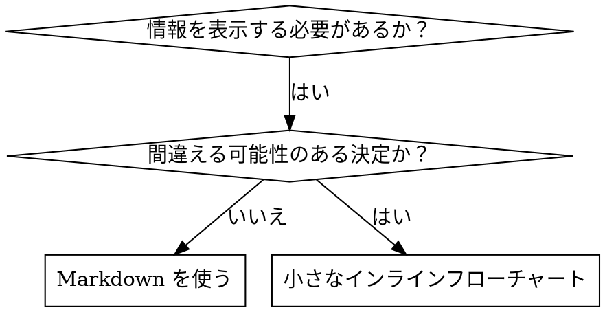

# スキル内のフローチャート

superpowers:writing-skills の一部。

## フローチャートの使用



**フローチャートは以下の場合にのみ使用します：**
- 自明でない決定点
- 早すぎる段階で停止する可能性のあるプロセスループ
- 「AとBのどちらを使用するか」の決定

**フローチャートを絶対に使用しない場合：**
- 参考資料 → 表、リスト
- コード例 → マークダウンブロック
- 線形の指示 → 番号付きリスト
- 意味のないラベル（step1、helper2）

Graphviz のスタイル規則は同じディレクトリの `graphviz-conventions.dot` に従います。

**人間パートナー向けに可視化する場合:** writing-skills ディレクトリの `render-graphs.js` でスキルの DOT フローチャートを SVG に変換します（writing-skills ディレクトリで実行します）。

```bash
node ./render-graphs.js ../some-skill           # 図を個別に出力
node ./render-graphs.js ../some-skill --combine # すべての図を1つのSVGにまとめる
```
